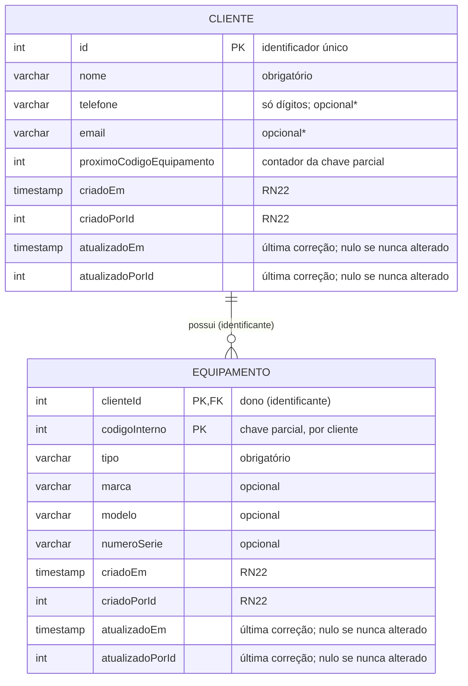

# SysOS — Modelo de dados (protótipo: Cliente e Equipamento)

Documentado **antes do código**, conforme a contingência do slide de riscos
("Dificuldade de integração entre Prisma ORM e modelagem do banco de dados").
Para revisão do Dev Backend e do Analista de Sistemas.

## Diagrama

\* CHECK no banco: ao menos um entre `telefone` e `email` (RN07/RF04).

## Equipamento como entidade fraca

| Característica | Como está modelado |
|---|---|
| Não existe sem cliente | `clienteId` é NOT NULL e FK para `Cliente` |
| Identificação depende do dono | PK composta `(clienteId, codigoInterno)` |
| Chave parcial | `codigoInterno`: 1, 2, 3… **por cliente**, gerado pelo sistema (RN09) |
| Relacionamento identificante | FK faz parte da PK; API aninhada em `/clientes/:id/equipamentos` |
| Sem exclusão em cascata | `ON DELETE RESTRICT` (RN20: nada apaga histórico) |

**Geração do código interno:** na mesma transação, `UPDATE Cliente SET
proximoCodigoEquipamento = proximoCodigoEquipamento + 1` (trava a linha) e
`INSERT` do equipamento com o valor anterior. Dois cadastros simultâneos para o
mesmo cliente nunca recebem o mesmo código, e se o `INSERT` falhar o incremento
é desfeito (sem registro pela metade — RF12 / RNF "operação transacional").

## Alteração e exclusão (CRUD completo — PB18)

| Regra | Como está garantida |
|---|---|
| Alteração mantém identidade e vínculos | `id` do cliente e `(clienteId, codigoInterno)` do equipamento nunca são atualizados; a API recusa esses campos no corpo |
| Quem corrigiu e quando (RN22) | Colunas `atualizadoEm` e `atualizadoPorId` (migration `0002_crud_atualizacao`), preenchidas pelo código na alteração. Nulas na criação, por isso não se usa `@updatedAt` |
| Cliente com equipamento/OS não é excluído (RN20) | FK com `ON DELETE RESTRICT`: o próprio banco recusa, sem janela entre "conferir" e "apagar" |
| Equipamento com OS não é excluído (RN20) | Quando a tabela de OS existir, sua FK para `(clienteId, codigoInterno)` com `RESTRICT` fará o banco recusar; a API já traduz a recusa em `409 EQUIPAMENTO_COM_VINCULOS` |
| Identificadores excluídos não são reaproveitados | `id` vem de sequência (`SERIAL`) e `proximoCodigoEquipamento` só cresce, então não há reuso |

Registros existentes continuam válidos: a migration `0002` só acrescenta colunas
opcionais, sem preenchimento retroativo.

**Por que isso ajuda o próximo passo:** a futura `OrdemServico` referenciará
`(clienteId, codigoInterno)` e ainda guardará `clienteId`; assim o banco garante
sozinho a RN01 (o equipamento da OS é do mesmo cliente da OS).

## Decisões de campos (documentado x proposto)

| Decisão | Origem |
|---|---|
| Cliente exige nome + ao menos um contato; CPF e endereço não são coletados | RN07 / backlog PB02 (mínimo de dados — LGPD) |
| Equipamento: tipo obrigatório; marca, modelo e série opcionais; sempre tem código interno | RF07 / RN09 |
| Telefone guardado só com dígitos (DDD + número); e-mail em minúsculas | **Proposta** (facilita busca e detecção de duplicidade) |
| `tipo` é texto livre (até 60 caracteres) | **Proposta** — lista de tipos ainda não definida |
| Duplicidade de cliente: alerta (nome igual sem diferenciar maiúsculas, ou mesmo telefone/e-mail) e exige confirmação; nunca mescla | RN08 (critério exato é proposta) |
| `criadoPorId` e `atualizadoPorId` sem FK | Tabela de contas pertence ao PB01/PB08, fora desta entrega |
| Exclusão só de cadastro sem vínculos; sem inativação (exclusão lógica) | **Proposta** — o PB18 deixa exclusão/inativação "dependentes de política própria a acordar". Se o grupo preferir inativar em vez de excluir, é uma coluna `ativo` e a troca do `DELETE` por `PATCH` |
| `PUT` substitui todos os campos editáveis (não é parcial) | **Proposta** — mesmo corpo do cadastro, o que simplifica o formulário de edição |
| Matriz de acesso: só `ATENDENTE` altera e exclui | **Proposta** — o PB18 diz "atendente autorizado"; a matriz oficial é do PB01 |
