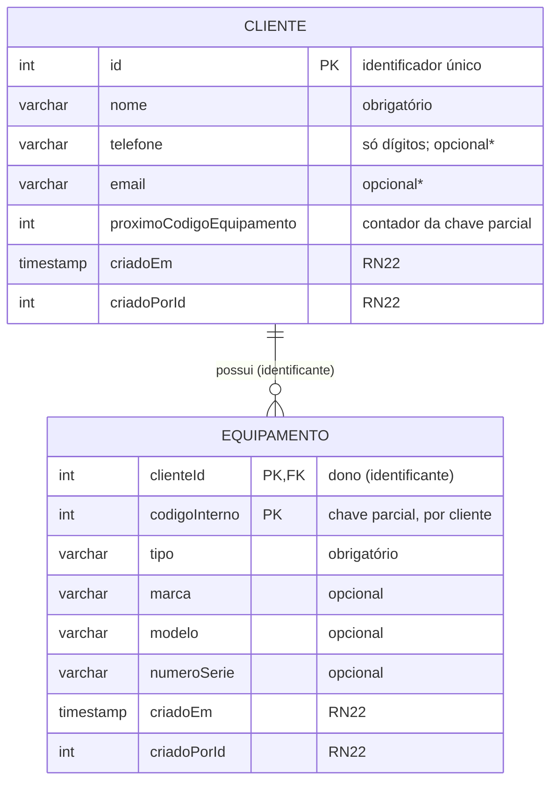

# SysOS — Modelo de dados (protótipo: Cliente e Equipamento)

Documentado **antes do código**, conforme a contingência do slide de riscos
("Dificuldade de integração entre Prisma ORM e modelagem do banco de dados").
Para revisão do Dev Backend e do Analista de Sistemas.

## Diagrama

\* CHECK no banco: ao menos um entre `telefone` e `email` (RN07/RF04).

## Equipamento como entidade fraca

| Característica | Como está modelado |
|---|---|
| Não existe sem cliente | `clienteId` é NOT NULL e FK para `Cliente` |
| Identificação depende do dono | PK composta `(clienteId, codigoInterno)` |
| Chave parcial | `codigoInterno`: 1, 2, 3… **por cliente**, gerado pelo sistema (RN09) |
| Relacionamento identificante | FK faz parte da PK; API aninhada em `/clientes/:id/equipamentos` |
| Sem exclusão em cascata | `ON DELETE RESTRICT` (RN20: nada apaga histórico) |

**Geração do código interno:** na mesma transação, `UPDATE Cliente SET
proximoCodigoEquipamento = proximoCodigoEquipamento + 1` (trava a linha) e
`INSERT` do equipamento com o valor anterior. Dois cadastros simultâneos para o
mesmo cliente nunca recebem o mesmo código, e se o `INSERT` falhar o incremento
é desfeito (sem registro pela metade — RF12 / RNF "operação transacional").

**Por que isso ajuda o próximo passo:** a futura `OrdemServico` referenciará
`(clienteId, codigoInterno)` e ainda guardará `clienteId`; assim o banco garante
sozinho a RN01 (o equipamento da OS é do mesmo cliente da OS).

## Decisões de campos (documentado x proposto)

| Decisão | Origem |
|---|---|
| Cliente exige nome + ao menos um contato; CPF e endereço não são coletados | RN07 / backlog PB02 (mínimo de dados — LGPD) |
| Equipamento: tipo obrigatório; marca, modelo e série opcionais; sempre tem código interno | RF07 / RN09 |
| Telefone guardado só com dígitos (DDD + número); e-mail em minúsculas | **Proposta** (facilita busca e detecção de duplicidade) |
| `tipo` é texto livre (até 60 caracteres) | **Proposta** — lista de tipos ainda não definida |
| Duplicidade de cliente: alerta (nome igual sem diferenciar maiúsculas, ou mesmo telefone/e-mail) e exige confirmação; nunca mescla | RN08 (critério exato é proposta) |
| `criadoPorId` sem FK | Tabela de contas pertence ao PB01/PB08, fora desta entrega |
