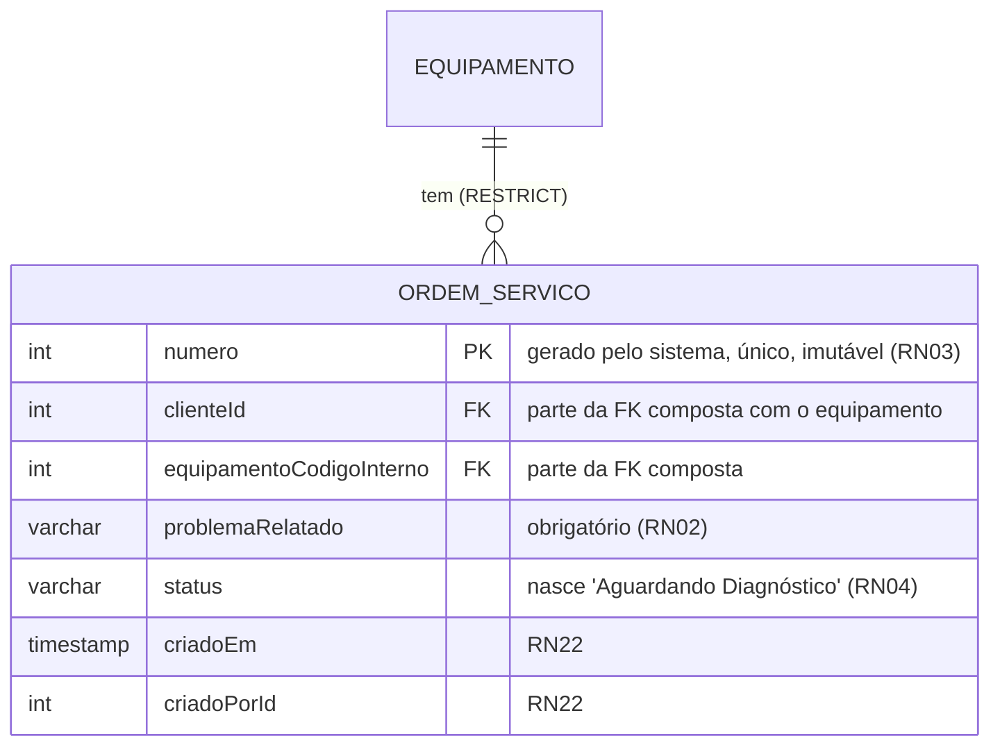

# SysOS — Ordem de serviço (abrir e consultar)

Implementa **PB04 (abrir OS)** e **PB05 (consultar OS)**: RF09 a RF15 e RN01 a
RN06 do documento "Requisitos e RN — SysOS". Fora desta entrega: mudança de
status, diagnóstico, orçamento e reparo (PB09 em diante), login (PB01).

## Modelo de dados



- A FK composta `(clienteId, equipamentoCodigoInterno)` → `Equipamento` faz o
  **banco** garantir a RN01 (o equipamento é do mesmo cliente da OS).
- `ON DELETE RESTRICT`: cliente ou equipamento com OS não é excluído (RN20). A
  API devolve `409 CLIENTE_COM_VINCULOS` / `409 EQUIPAMENTO_COM_VINCULOS`.
- O número vem de uma sequência do PostgreSQL: é único e nunca se repete, mas
  pode haver "buracos" (uma tentativa que falha consome o número).
- Migration: `prisma/migrations/0003_ordem_servico` (só cria a tabela nova).

## Endpoints

Todos sob `/api`, com `Authorization: Bearer <token>` (RF02).

| Método e rota | Perfil | O que faz |
|---|---|---|
| `POST /api/ordens-servico` | atendente | Abre a OS. `201` com a OS e o cabeçalho `Location` |
| `GET /api/ordens-servico?clienteId=&status=` | atendente, técnico | Lista (mais recentes primeiro, até 100), com filtros opcionais |
| `GET /api/ordens-servico/:numero` | atendente, técnico | Consulta uma OS por número |

Não existem `PUT`, `PATCH` nem `DELETE` para a OS (`404 ROTA_NAO_ENCONTRADA`).

### Abrir OS — corpo

```json
{
  "clienteId": 1,
  "equipamentoCodigoInterno": 1,
  "problemaRelatado": "Não liga",
  "confirmarOsEmAberto": false
}
```

`confirmarOsEmAberto` é opcional. Número, status e autor **não** são aceitos no
corpo (`400`): são gerados pelo sistema.

### Resposta (abrir e consultar)

```json
{
  "numero": 1,
  "status": "Aguardando Diagnóstico",
  "problemaRelatado": "Não liga",
  "criadoEm": "2026-11-20T23:54:44.640Z",
  "criadoPorId": 7,
  "cliente": { "id": 1, "nome": "Maria da Silva", "telefone": "42999991234", "email": "maria@exemplo.com" },
  "equipamento": { "codigoInterno": 1, "tipo": "Notebook", "marca": "Dell", "modelo": "Inspiron", "numeroSerie": "ABC123" }
}
```

A listagem devolve `{ "total": 2, "ordens": [ ...mesmo formato... ] }`.

### Erros

| Situação | Status | `erro.codigo` | Regra |
|---|---|---|---|
| Falta cliente, equipamento ou problema; problema só com espaços; mais de 1000 caracteres | 400 | `DADOS_INVALIDOS` (com `detalhes` por campo) | RF10, RN02 |
| Cliente não cadastrado (`detalhes.ofertaCadastro: true`) | 404 | `CLIENTE_NAO_ENCONTRADO` | RN05, RF06 |
| Equipamento inexistente ou de outro cliente | 404 | `EQUIPAMENTO_NAO_ENCONTRADO` | RN01 |
| Equipamento já tem OS em aberto (`detalhes.ordensEmAberto` mostra a OS) | 409 | `EQUIPAMENTO_COM_OS_EM_ABERTO` | RF11, RN06 |
| Falha ao gravar (nada é gravado; sem SQL na resposta) | 500 | `FALHA_AO_GRAVAR` | RF12 |
| Número de OS inexistente | 404 | `ORDEM_SERVICO_NAO_ENCONTRADA` | RF13 |
| Sem token / perfil sem permissão | 401 / 403 | `NAO_AUTENTICADO` / `ACESSO_NEGADO` | RF02 |

### Exemplo (PowerShell)

```powershell
$TOKEN = npm run -s token:dev -- ATENDENTE 1
$h = @{ Authorization = "Bearer $TOKEN" }
$corpo = '{"clienteId":1,"equipamentoCodigoInterno":1,"problemaRelatado":"Não liga"}'
Invoke-RestMethod -Method Post -Uri http://localhost:3000/api/ordens-servico -Headers $h -ContentType "application/json; charset=utf-8" -Body ([Text.Encoding]::UTF8.GetBytes($corpo))
Invoke-RestMethod -Uri "http://localhost:3000/api/ordens-servico?clienteId=1" -Headers $h
Invoke-RestMethod -Uri http://localhost:3000/api/ordens-servico/1 -Headers $h
```

## Decisões: documentado x proposto

| Decisão | Origem |
|---|---|
| Número único, gerado pelo sistema, nunca muda; status inicial exato "Aguardando Diagnóstico" | RN03, RN04 (documentado) |
| Aviso de OS em aberto **não bloqueia**: devolve `409` e exige `confirmarOsEmAberto=true` | RN06 diz "proposta: só avisa e exige confirmação" |
| "Em aberto" = qualquer status diferente de `Concluída` e `Cancelada` | **Proposta** (o PB04 pede para definir); RN19 trata concluída/cancelada como só consulta |
| Matriz de acesso: atendente abre; atendente e técnico consultam | **Proposta** (a oficial é do PB01); o documento diz que o atendente abre e ambos consultam |
| `status` é texto (não enum) e o filtro é por igualdade exata | **Proposta**: os demais status só serão definidos no PB09 |
| Lista limitada a 100 OS, mais recentes primeiro | **Proposta** |
| A OS não é editada nem excluída | RN03, RN19, RN20; status muda no PB09 |

**Limite conhecido:** a checagem "já existe OS em aberto" e a gravação são
passos separados. Duas aberturas simultâneas do mesmo equipamento podem passar
juntas. Como o aviso só alerta (não bloqueia), isso é aceitável; se a política
virar bloqueio, será preciso uma restrição no banco.

## Rastreabilidade

| Item | Onde | Testes |
|---|---|---|
| RF09 abrir OS, número único, status inicial | `ordemServicoServico.abrir`, `OrdemServicoPrismaRepositorio.abrir` | `ordens.test.ts`, `ordens.int.test.ts` |
| RF10 / RN02 dado obrigatório | `validacaoOs.ts`, CHECK no banco | `ordens.test.ts`, `ordens.int.test.ts` |
| RF11 / RN06 OS em aberto | `buscarEmAbertoDoEquipamento`, `errosOs` | `ordens.test.ts`, `ordens.int.test.ts` |
| RF12 falha sem OS pela metade | `INSERT` único + `falhaGravacao` | `ordens.test.ts`, `ordens.int.test.ts` |
| RF13 consultar por número | `GET /:numero` | `ordens.test.ts` |
| RF14 listar por cliente e status | `GET /` | `ordens.test.ts`, `ordens.int.test.ts` |
| RF15 mostrar dados; consultar não altera | `OrdemDetalhada`, só `GET` | `ordens.test.ts` |
| RN01 equipamento do mesmo cliente | FK composta | `ordens.test.ts`, `ordens.int.test.ts` |
| RN03 / RN04 número e status do sistema | sequência, `STATUS_INICIAL`, `.strict()` | `ordens.test.ts`, `ordens.int.test.ts` |
| RN05 cliente não cadastrado | `erros.clienteNaoEncontrado` | `ordens.test.ts` |
| RN20 nada apaga o histórico | `ON DELETE RESTRICT` | `ordens.test.ts`, `ordens.int.test.ts` |
| RN22 quem fez e quando | `criadoPorId`, `criadoEm` | `ordens.test.ts`, `ordens.int.test.ts` |
| RF02 login e perfil | `rotasOs.ts` | `ordens.test.ts` |